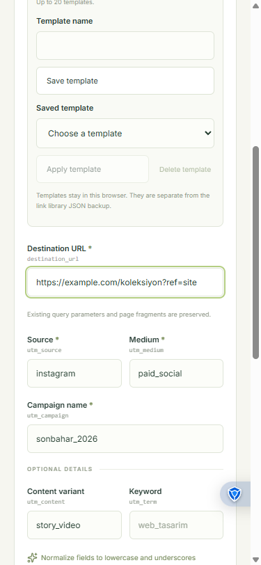

# Keyboard focus when leaving the library

Reusing a saved link opens the builder with the destination field focused. Starting a link from the empty library does the same. A subsequent Tab moves to Source. Sidebar navigation keeps focus on its navigation button.

## Reproduce the fixed problem

1. Use the example campaign and save it.
2. Open Campaign library (Kampanya kütüphanesi in Turkish).
3. Move focus to Reuse (Yeniden kullan) and press Enter.
4. Check that Destination URL (Hedef adres) receives focus and retains the saved destination.
5. Press Tab. Source (Kaynak) should receive focus.

Before the fix, the activated button was removed and focus fell back to the document body. The next keyboard action therefore did not continue from the populated form.

## Verification

Checked in Chrome 156 on Windows on 5 November 2026: Turkish at a 929px viewport and English at 375px. Both reused-link flows focused the destination and advanced to Source. The narrow view had no horizontal document overflow; the focus outline was visible.

Four component regressions cover reuse in both languages, starting from the empty library, and keeping focus on sidebar navigation. The first three fail before the fix. The complete automated suite passes 30 tests, and `npm run build` passes.

This is a focused check of the library-to-builder transition. It does not complete the broader keyboard audit in issue #4 or claim an accessibility certification.
